<p align="center">
  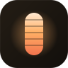
</p>

<h1 align="center">Wi-Fi Lamp</h1>

<p align="center">
  <b>Light that wakes up with you</b><br>
  A cylindrical lamp with 256 LEDs: sunrise alarm, fireplace, clock and New Year show
</p>

<p align="center">
  <b>English</b> · <a href="README.md">Русский</a>
</p>

<p align="center">
  
  
  
  
  
  
  
  
</p>

---

**Wi-Fi Lamp** is a complete smart lamp project: a flexible 16×16 WS2812B matrix is wrapped around a tube, with an ESP8266 inside. The firmware renders 17 scenes, wakes you gently with a sunrise on schedule, shows the time as a scrolling marquee and greets the New Year with fireworks. Control it with the touch button, a Material 3 Android app or a web panel that lives right in the lamp's memory. Both the firmware and the app update straight from GitHub.

## Features

**Light**
- 17 effects: aurora, fireplace, ocean, starfall, plasma, garland, Christmas spiral, candy, fireworks, clock and more.
- The garland looks like a real one: every bulb glows in its own warm color, twinkles and flashes.
- Cylindrical mapping: a seamless 16-pixel ring, calibration for serpentine, mirror, flip and offset.
- Playlist with auto-switch every 5–60 minutes, global brightness and an accent color.
- Gamma correction, configurable power-supply current limit (9 A by default) and smooth crossfades.

**Time**
- All 465 IANA time zones on board — pick one in the "Clock" section with name search.
- Manual date and time setting: without internet the clock and alarms keep working.
- Normal mode is NTP auto-sync against any of three servers; switch back with one button.
- Time scrolls around the cylinder: date, 12/24-hour format, color and speed.

**Morning**
- Up to four sunrise alarms with weekday selection.
- 5–30 minute wake-up: a warm glow rising from the bottom, then soft morning light.
- Maximum brightness cap, snooze and auto-off after waking.
- Works without a phone or internet — time comes from NTP and lives in the lamp.

**Control**
- TTP223 touch sensor: tap — next effect, double tap — on/off, hold — brightness.
- During sunrise a tap snoozes, a hold turns the light off.
- Holding the sensor at power-on (3 s) resets Wi-Fi — for when the router or password changed.
- Android app: Material 3, live matrix preview, home-screen widget and quick-settings tile.
- Web panel with zero external dependencies — a fast UI with dark and light themes.
- If Wi-Fi is not configured or unreachable, the lamp keeps an open `Lampa-Setup` access point with a setup portal; on every boot it stays available for the first few seconds even with working settings.

**Holidays**
- "Days to New Year" effect with a countdown.
- New Year show: fireworks, greeting and a festive scene at midnight on January 1.

**Updates**
- Firmware: upload a file manually or update online from GitHub — the lamp checks releases, shows notes and updates with live progress in the web panel and the app.
- The Android app self-updates from GitHub in the same release: "Settings → App → Check".

**Connectivity**
- REST API and WebSocket on one device, state syncs within 150 ms.
- Live 16×16 preview: 768-byte binary frames straight into the app and the browser.
- mDNS name `lampa.local`, over-the-air firmware updates from the app or web panel.

## Interface

### Web panel

| Overview, light theme | Effects |
| --- | --- |
| 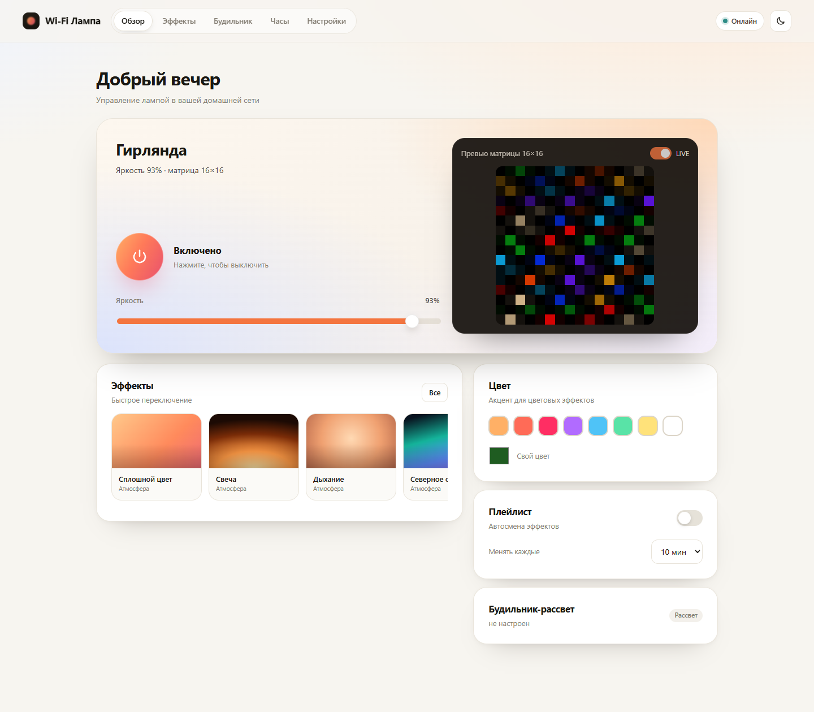 | 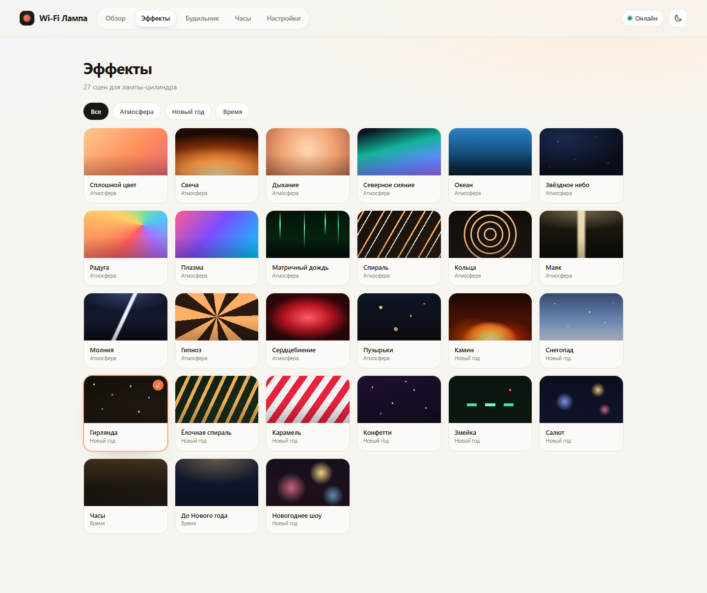 |

| Sunrise alarm | Settings, calibration and updates |
| --- | --- |
| 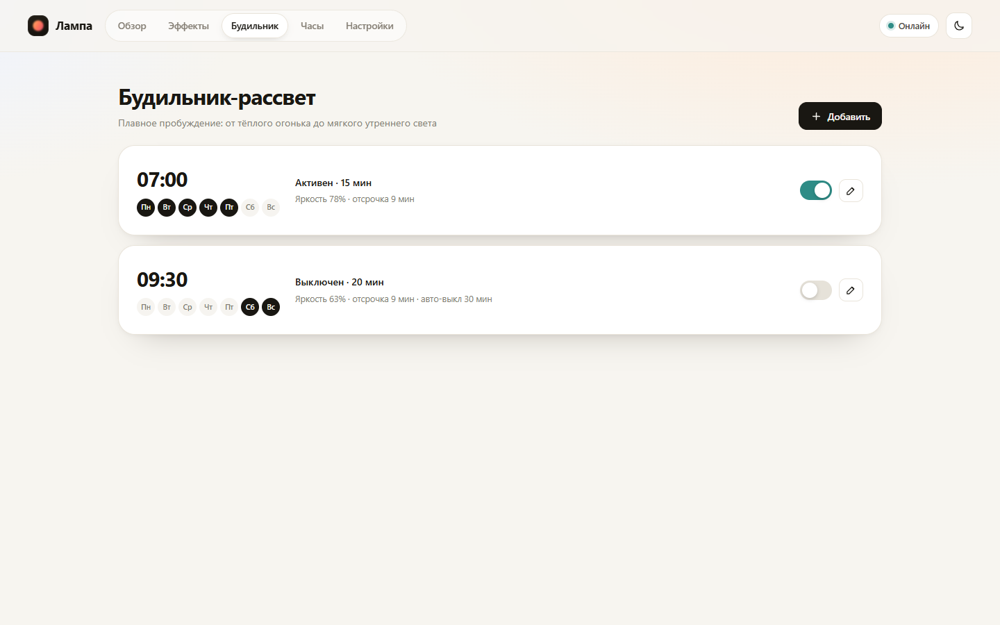 | 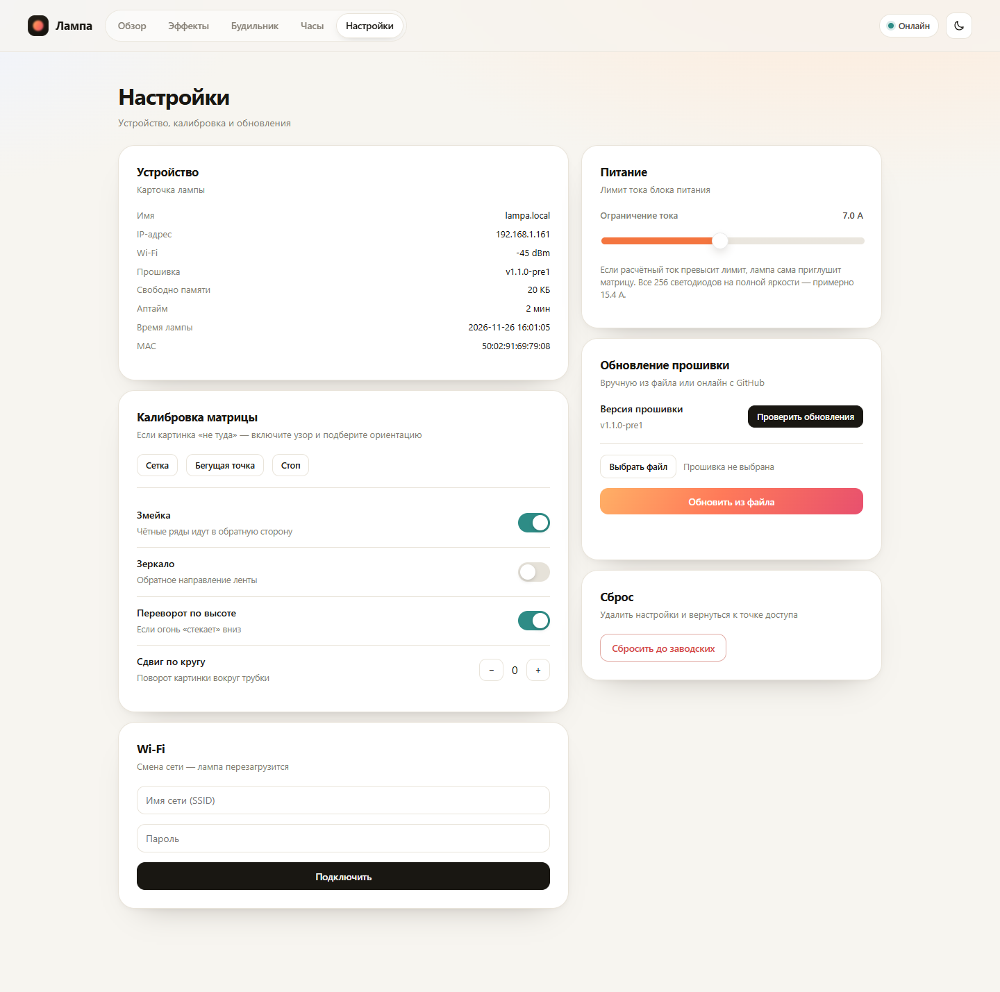 |

| Clock: time and time zones | Mobile layout |
| --- | --- |
| 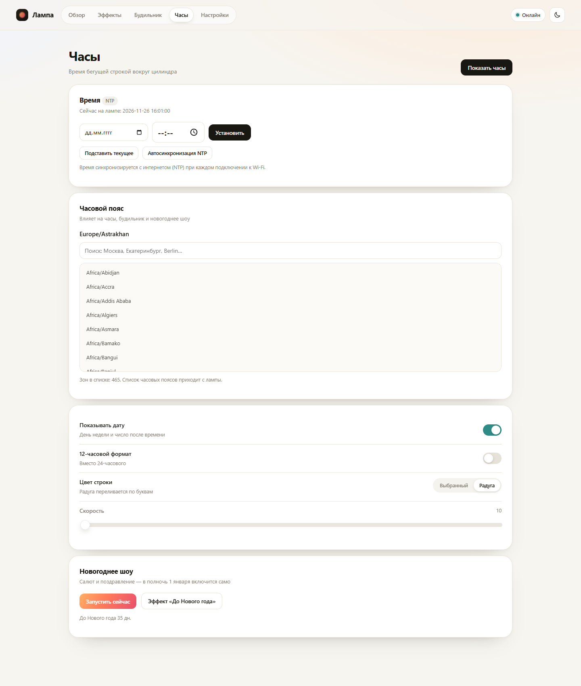 | 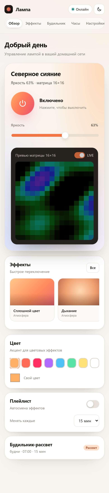 |

Dark theme and the first-run portal:

| Dark theme | `Lampa-Setup` access point |
| --- | --- |
| 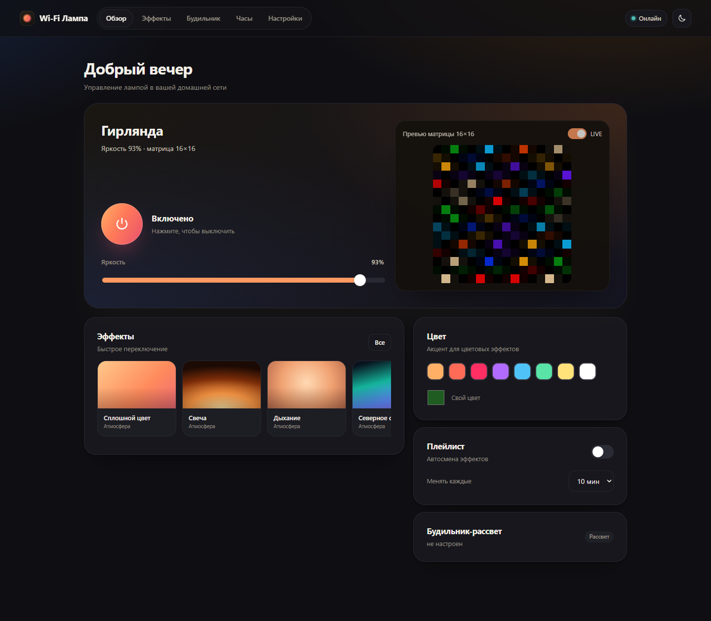 | 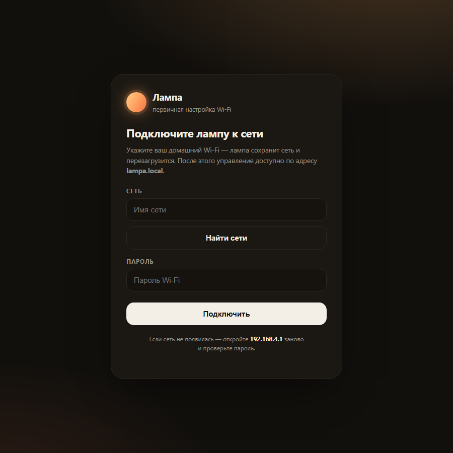 |

### Android

<p align="center">
  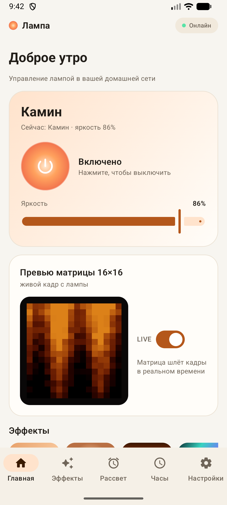
  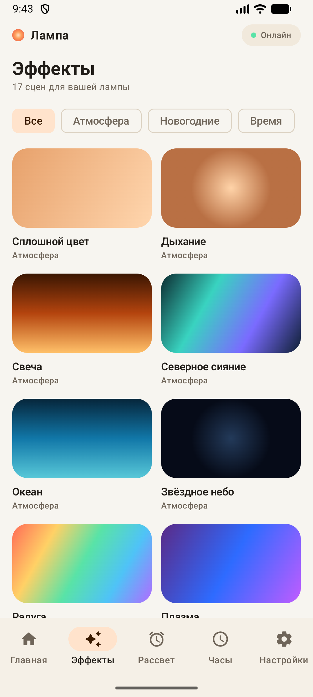
  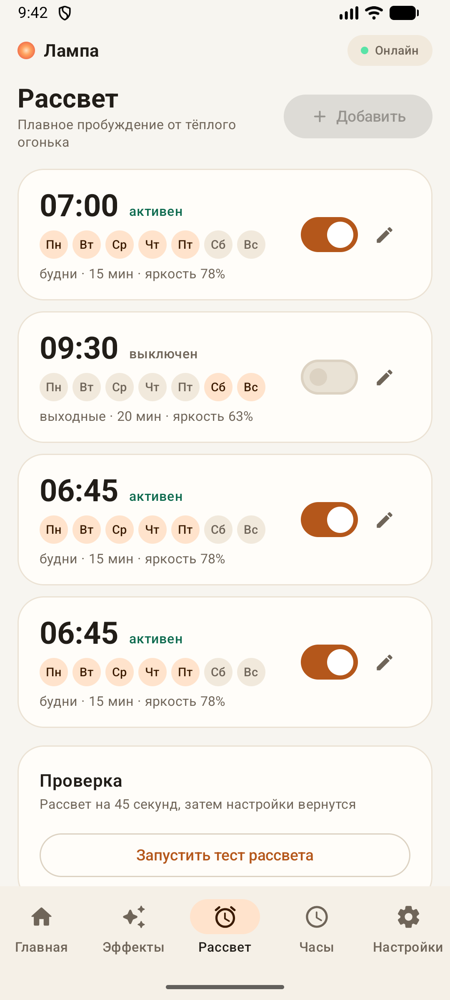
  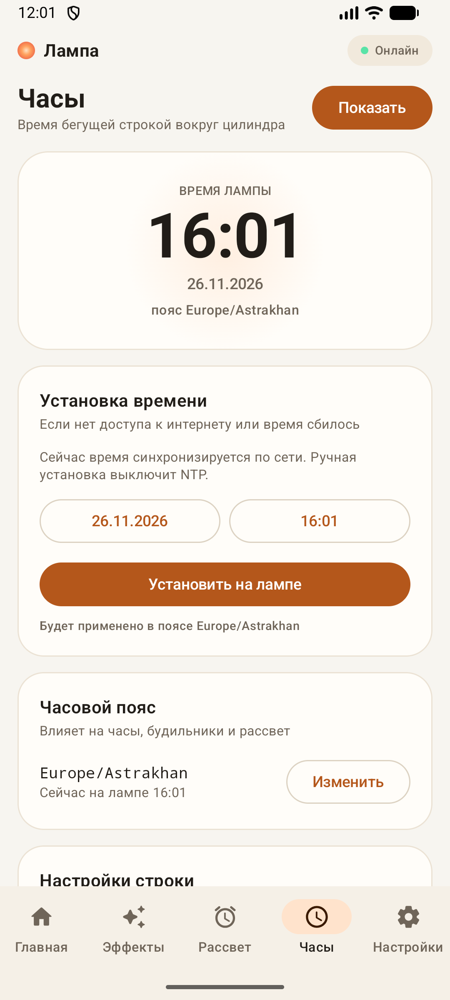
</p>

<p align="center">
  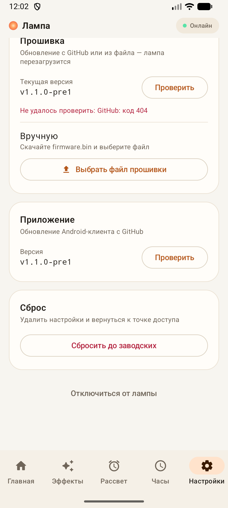
  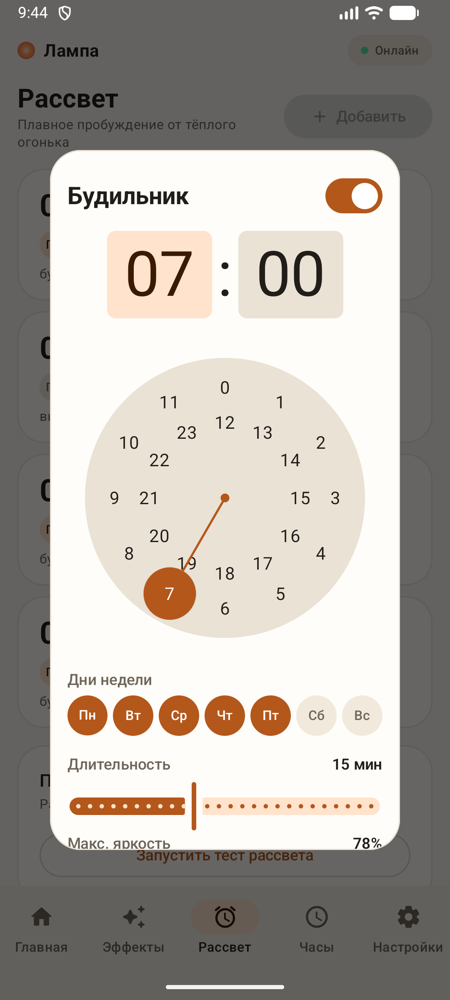
  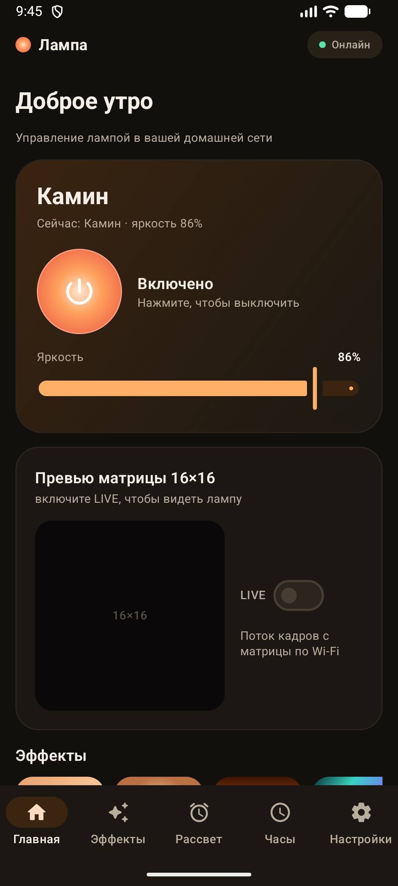
</p>

## Hardware

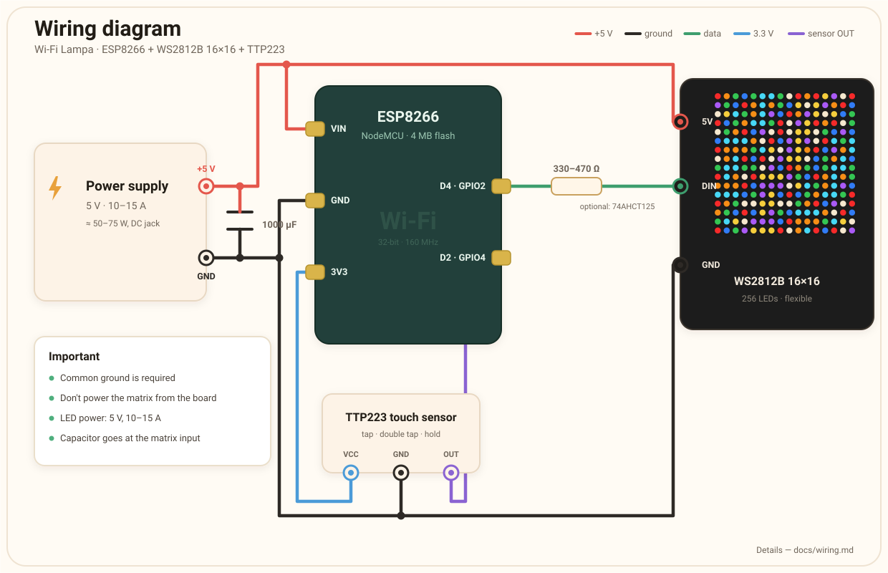

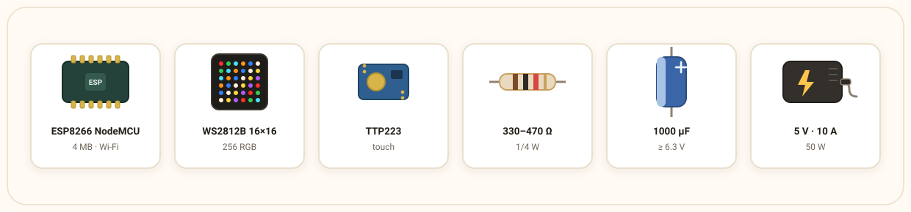

| Component | Qty | Purpose |
| --- | --- | --- |
| ESP8266 NodeMCU v2/v3, 4 MB | 1 | Wi-Fi, effects, API |
| WS2812B 16×16 flexible matrix | 1 | 256 RGB LEDs |
| TTP223 touch sensor | 1 | tap, double tap, hold |
| 330–470 Ω resistor | 1 | data line termination |
| 1000 µF capacitor | 1 | smooths current spikes at the matrix |
| 74AHCT125 | 1 | 3.3 → 5 V level shifter, optional |
| 5 V 10–15 A power supply | 1 | powers the matrix |
| DC jack, terminal block, wires | — | assembly |

Shopping links (Russia / China) will be added here later.

The essentials: never power the matrix from the board — full-brightness white draws up to 15 A. Wiring — DIN → D4 (GPIO2) via a 330–470 Ω resistor, sensor — OUT → D2 (GPIO4), common ground is mandatory. The firmware limits total current via the "Power" setting (500–15000 mA): if your supply is weaker than 15 A, set its rating — the lamp dims bright scenes instead of tripping the supply.

## Quick start

You don't need to build anything. Everything ready-made is in the [releases](https://github.com/denvisss/wi-fi-lampa/releases):

- **`lampa-full.bin`** — complete image: firmware + web UI, 4 MB;
- **`lampa-android.apk`** — the Android app.

### 1. Flash the board

**Web flasher** — no software to install, Chrome or Edge required:

1. Connect the board over USB. If no port shows up, install the CH340 driver.
2. Open [esptool.spacehuhn.com](https://esptool.spacehuhn.com/) and press **Connect**, pick the port.
3. Press **Choose file** and select `lampa-full.bin`. Keep the address at `0x0`.
4. **Program** → wait for success (1–3 minutes). The board reboots by itself.

**Flash Download Tool** — Espressif's Windows utility:

1. Download [Flash Download Tools](https://www.espressif.com/en/support/download/other-tools) and launch it.
2. ChipType — **ESP8266**, WorkMode — **Develop**, LoadMode — **UART**.
3. File `lampa-full.bin`, address **0x0**, SPI SPEED — **40MHz**, SPI MODE — **DIO**, FLASH SIZE — **32Mbit**.
4. COM port → **START** → wait for `FINISH`, then power-cycle.

Detailed instructions, drivers and split flashing (`firmware.bin` + `littlefs.bin`) — in [docs/flash.md](docs/flash.md) (Russian).

### 2. Set up Wi-Fi

1. After flashing the lamp raises an open **Lampa-Setup** network.
2. Join it from your phone — the setup page opens automatically (or go to `http://192.168.4.1`).
3. Pick your home network, enter the password and press "Connect" — the lamp reboots.

### 3. Open the web panel

`http://lampa.local` in a browser, or the lamp's IP from the router's client list. Sections: "Overview" — effect, brightness, color; "Effects" — the 17-scene catalog; "Alarm" — sunrises; "Clock" — time, time zone and manual setting; "Settings" — matrix calibration, current limit, Wi-Fi and updates.

### 4. Connect the app

1. Install `lampa-android.apk` (Android 8.0+, allow installing from this source).
2. On the "Connect to the lamp" screen the address is already filled in — `lampa.local`; press "Connect". If mDNS doesn't work in your network, type the lamp's IP.
3. Tabs: "Home" — brightness and the live 16×16 preview, "Effects", "Sunrise" — alarms with a test run, "Clock", "Settings" — calibration, power, Wi-Fi, firmware, app, reset.

### 5. Stay updated from GitHub

"Settings → Firmware → Check" — the lamp updates itself from GitHub, settings are kept. "Settings → App → Check" — a fresh APK. No manual builds needed.

For development — `npm run embed`, then `pio run -t upload` and `pio run -t uploadfs` inside `firmware` (see [Development](#development)).

## Firmware updates

1. **From GitHub** — "Settings → Firmware → Check" in the web panel or the app; the lamp shows the version and notes, installs on a button press and reboots.
2. **From a file** — "Choose firmware file": any `firmware.bin` works.
3. **Over the air from the console** — `pio run -t upload --upload-protocol espota --upload-port lampa.local`.
4. **USB flasher** — `lampa-full.bin` at address `0x0` (see [Quick start](#quick-start)).

The Android app updates itself: "Settings → App → Check" downloads the APK from the release.

## How it works

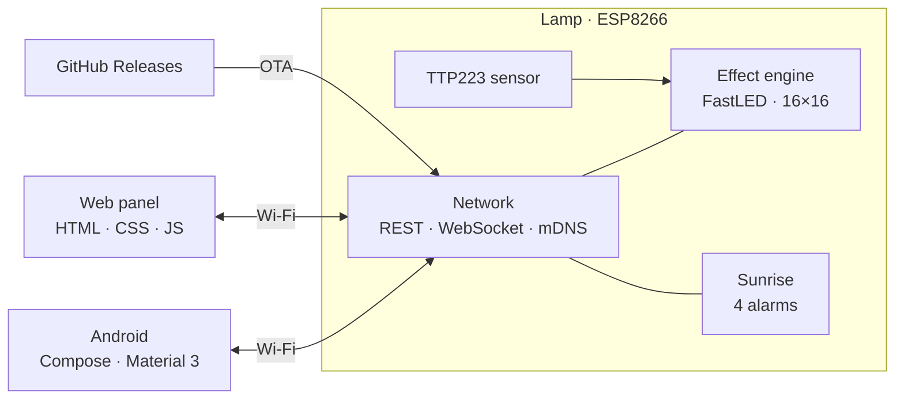

The firmware is a small real-time core: a 16 ms tick, crossfaded scene changes, a sunrise layer on top of effects and a network state broadcast to all clients at once. The web UI and the Android app keep no state of their own — the lamp is the single source of truth.

The time zone table (IANA → POSIX) lives in flash and is generated by `tools/gen-tz.mjs`; the lamp serves the zone list itself, so clients need no copies.

## Development

### Web panel

```bash
npm run mock     # local server emulating the lamp: http://localhost:8080
npm run embed    # web/* → firmware/data + gzip for LittleFS
```

No bundler, no frameworks: `index.html`, `styles.css`, `app.js`. The `web/mock-server.mjs` emulator mirrors REST, WebSocket, preview and the sunrise scenario — handy for UI work without hardware.

### Android

```bash
cd android
./gradlew assembleDebug
```

JDK 17+ and Android SDK 35 required. Stack: Kotlin 2.0, Jetpack Compose, Material 3, OkHttp, kotlinx.serialization. Package `com.denvisss.lampa`.

### Firmware

```bash
npm run embed
cd firmware
pio run          # build
pio run -t upload
pio device monitor
```

PlatformIO pulls ESP8266 Core, FastLED, ArduinoJson and WebSockets automatically. Effect, alarm and Wi-Fi settings live in LittleFS and are mirrored to EEPROM: they survive firmware updates and even a formatting `uploadfs`.

Refresh the time zone table (when IANA publishes changes):

```bash
node tools/gen-tz.mjs   # tools/tz-zones.csv → firmware/src/tzdata.h
```

## Repository layout

```
.
├── firmware/          ESP8266 firmware (PlatformIO)
│   ├── src/           core, effects, sunrise, network, API, touch, OTA
│   └── data/          built web UI for LittleFS
├── web/               web panel and its emulator
├── android/           Kotlin + Compose app
├── docs/              hardware, flashing, API, screenshots
└── tools/             web embedding, time zone table
```

## API at a glance

| Method | Path | Purpose |
| --- | --- | --- |
| `GET` | `/api/state` | Full lamp state |
| `POST` | `/api/state` | Partial settings update |
| `GET` | `/api/effects` | Effect catalog |
| `GET` | `/api/timezones` | All time zones (465 IANA zones) |
| `PUT` | `/api/alarms` | Sunrise schedules |
| `POST` | `/api/action` | Sunrise, manual time, calibration, show, reset |
| `POST` | `/api/wifi` | Change network |
| `POST` | `/api/ota` | Firmware file upload |
| `GET` | `/api/update/check` | Check GitHub for an update |
| `POST` | `/api/update/install` | Install the GitHub update |

WebSocket `ws://lampa.local:81/` delivers state, sunrise progress, OTA progress and binary preview frames. Full contract — [docs/api.md](docs/api.md) (Russian).

## Status

Version 1.2.0-pre1 runs on a real lamp: Wi-Fi, clock with manual setting and all time zones, matrix calibration, current limiting, GitHub updates and EEPROM settings restore after filesystem formatting are verified on hardware. The web panel is tested in Chrome against the live lamp — from 390 px to desktop; the Android app is built and tested on an emulator against the live lamp: screens, live preview, alarms, clock and updates work.

## License

[MIT](LICENSE) © denvisss
