<p align="center">
  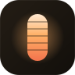
</p>

<h1 align="center">Лампа</h1>

<p align="center">
  <b>Свет, который просыпается вместе с вами</b><br>
  Цилиндрическая лампа на 256 светодиодах: рассвет-будильник, камин, часы и новогоднее шоу
</p>

<p align="center">
  <a href="README.en.md">English</a> · <b>Русский</b>
</p>

<p align="center">
  
  
  
  
  
  
  
  
</p>

---

**Лампа** — это законченный проект умного светильника: гибкая матрица WS2812B 16×16 намотана вокруг трубки, а внутри ESP8266. Прошивка рисует 17 сцен, плавно будит рассветом по расписанию, показывает время бегущей строкой и встречает Новый год салютом. Управление — сенсорной кнопкой, приложением Android в стиле Material 3 или веб-панелью, которая живёт прямо в памяти лампы. Прошивка и приложение обновляются прямо с GitHub.

## Что умеет

**Свет**
- 17 эффектов: северное сияние, камин, океан, звездопад, плазма, гирлянда, ёлочная спираль, карамель, салют, часы и другие.
- Гирлянда — как настоящая: каждая лампочка горит своим цветом из тёплой палитры, мерцает и вспыхивает.
- Цилиндрическая развёртка: бесшовный круг 16 пикселей, калибровка змейки, зеркала, переворота и сдвига.
- Плейлист с автопереключением каждые 5–60 минут, глобальная яркость и акцентный цвет.
- Гамма-коррекция, настраиваемый лимит тока блока питания (по умолчанию 9 А) и плавные переходы между сценами.

**Время**
- Все 465 часовых поясов IANA прямо в лампе — выбираются в разделе «Часы» с поиском по названию.
- Ручная установка даты и времени: если интернета нет, часы и будильники продолжают работать.
- Обычный режим — автосинхронизация по NTP с любого из трёх серверов; возврат к ней одной кнопкой.
- Время выводится бегущей строкой вокруг цилиндра: дата, 12/24-часовой формат, цвет и скорость.

**Утро**
- До четырёх будильников-рассветов с выбором дней недели.
- Пробуждение 5–30 минут: тёплый огонёк снизу вверх, затем мягкий утренний свет.
- Ограничение максимальной яркости, отсрочка и авто-выключение после пробуждения.
- Работает без телефона и интернета — время берётся по NTP и хранится в лампе.

**Управление**
- Сенсор TTP223: тап — следующий эффект, двойной тап — вкл/выкл, удержание — яркость.
- Во время рассвета тап откладывает его, удержание — выключает свет.
- Удержание сенсора при включении (3 с) сбрасывает Wi-Fi — если роутер сменился или пароль забыт.
- Android-приложение: Material 3, живое превью матрицы, виджет на домашнем экране и плитка в шторке.
- Веб-панель без единой внешней зависимости — быстрый интерфейс с тёмной и светлой темой.
- Если Wi-Fi не настроен или недоступен, лампа держит открытую точку доступа `Lampa-Setup` с порталом настройки; при каждом включении она доступна первые секунды даже с рабочими настройками.

**Праздник**
- Эффект «До Нового года» с обратным отсчётом.
- Новогоднее шоу: салют, поздравление и праздничная сцена автоматически в полночь 1 января.

**Обновления**
- Прошивка: вручную файлом или онлайн с GitHub — лампа сама проверит релизы, покажет заметки и обновится с прогрессом в веб-панели и приложении.
- Android-приложение обновляется с GitHub из того же релиза: «Настройки → Приложение → Проверить».

**Связь**
- REST API и WebSocket на одном устройстве, состояние синхронизируется за 150 мс.
- Живое превью 16×16: бинарные кадры 768 байт прямо в приложение и браузер.
- mDNS-имя `lampa.local`, обновление прошивки по воздуху из приложения или веб-панели.

## Интерфейс

### Веб-панель

| Обзор, светлая тема | Эффекты |
| --- | --- |
| 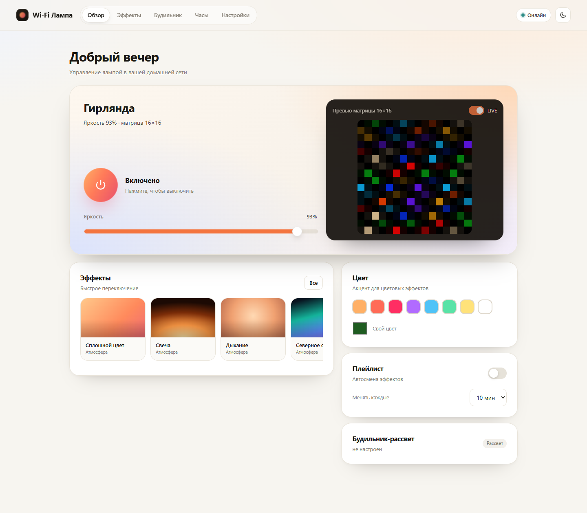 | 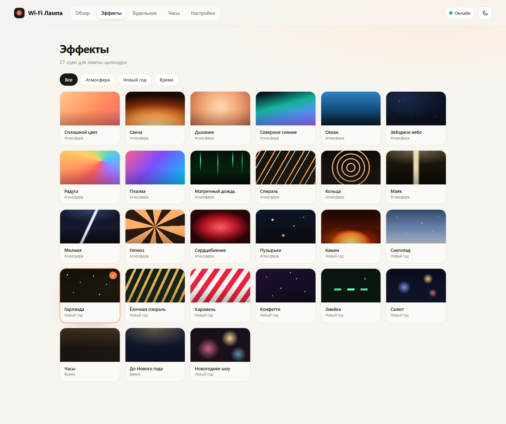 |

| Будильник-рассвет | Настройки, калибровка и обновления |
| --- | --- |
| 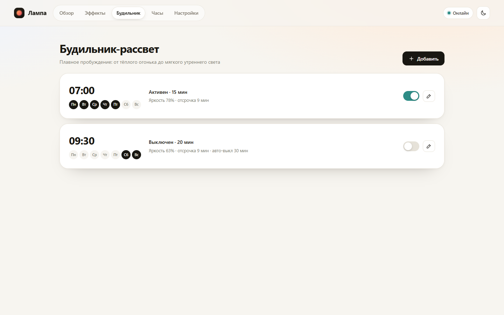 | 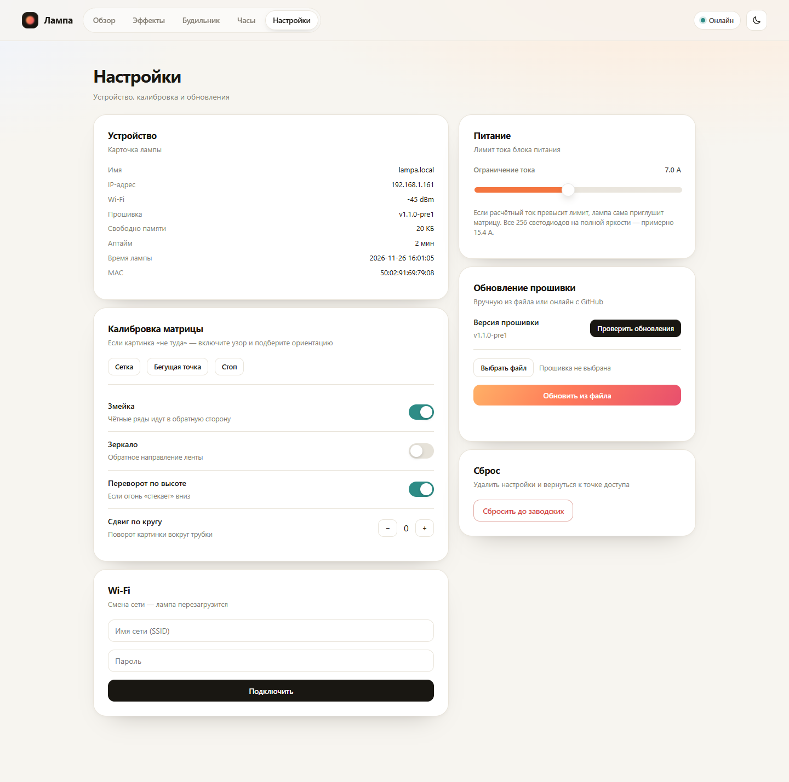 |

| Часы: время и часовые пояса | Мобильная версия |
| --- | --- |
| 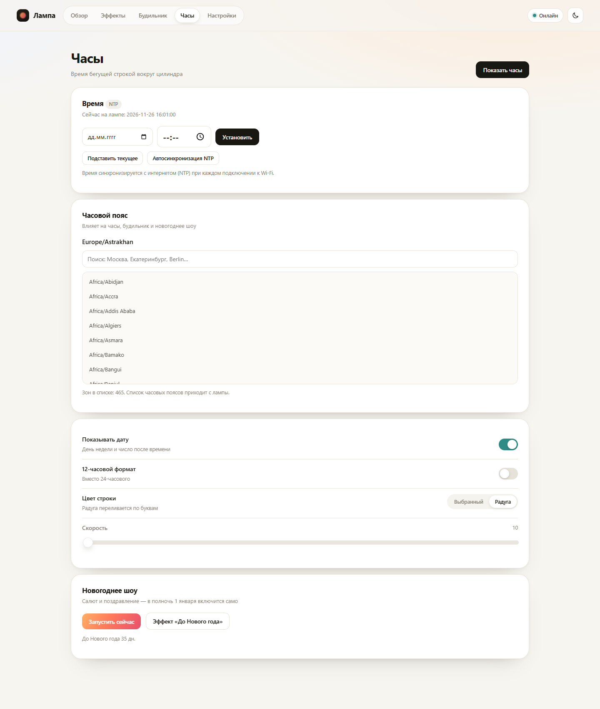 | 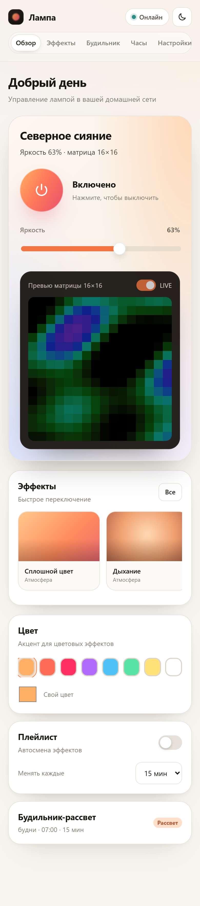 |

Тёмная тема и портал первого запуска:

| Тёмная тема | Точка доступа `Lampa-Setup` |
| --- | --- |
| 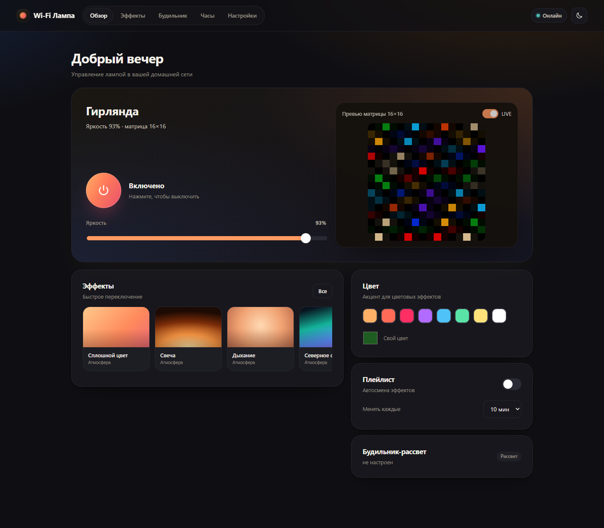 | 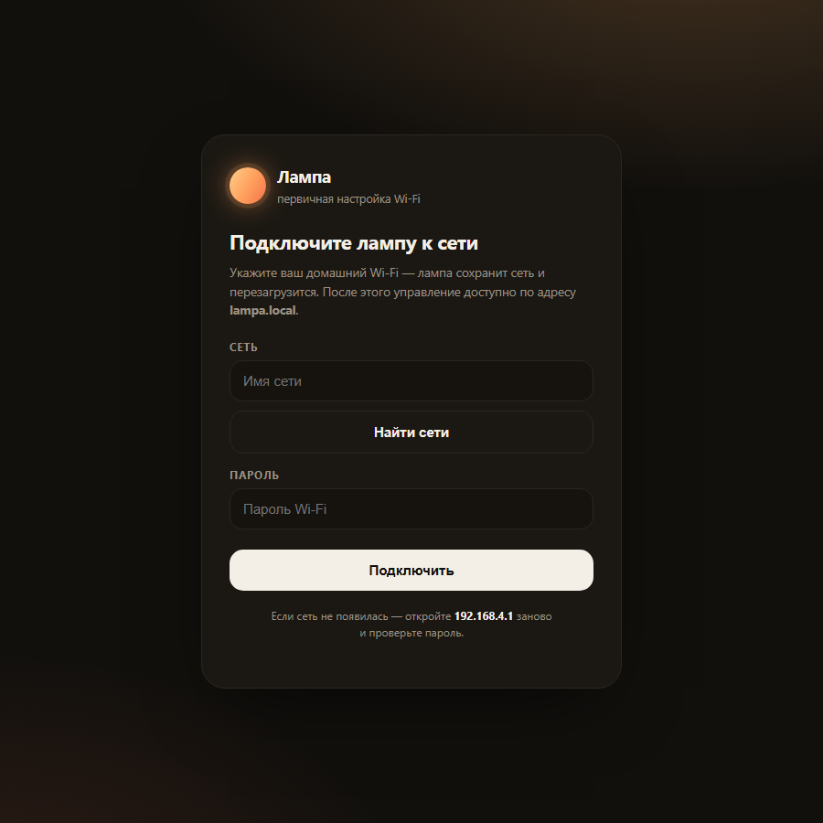 |

### Android

<p align="center">
  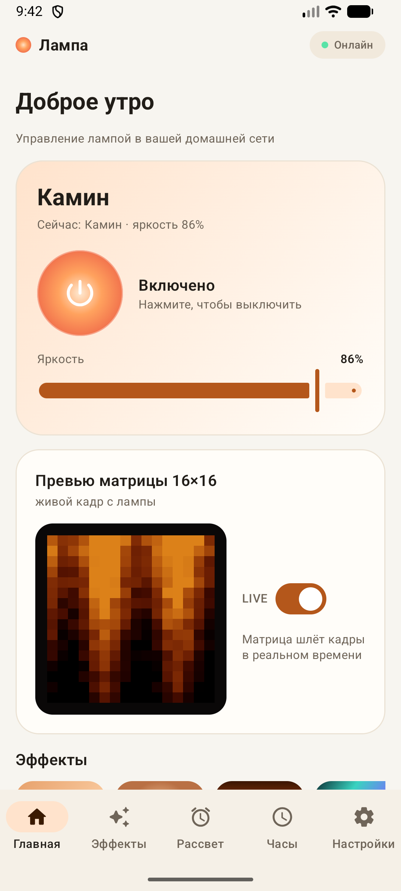
  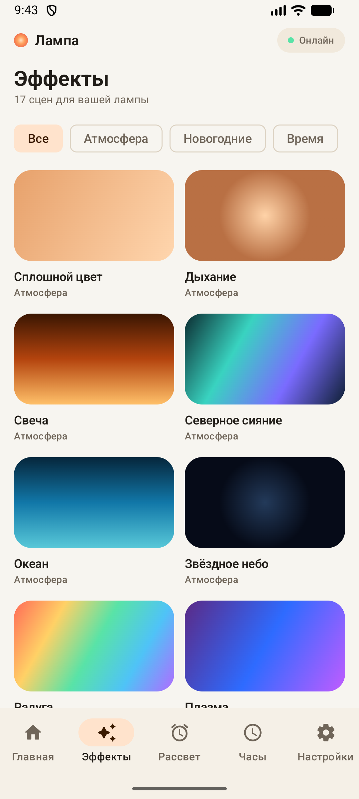
  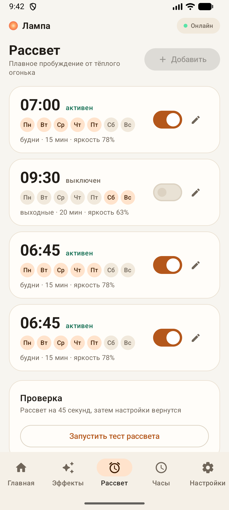
  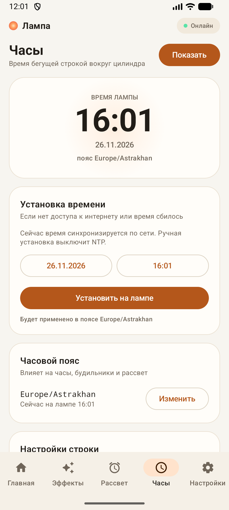
</p>

<p align="center">
  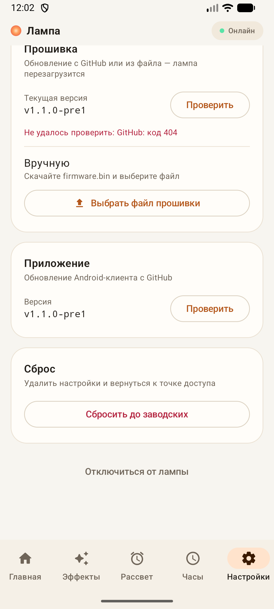
  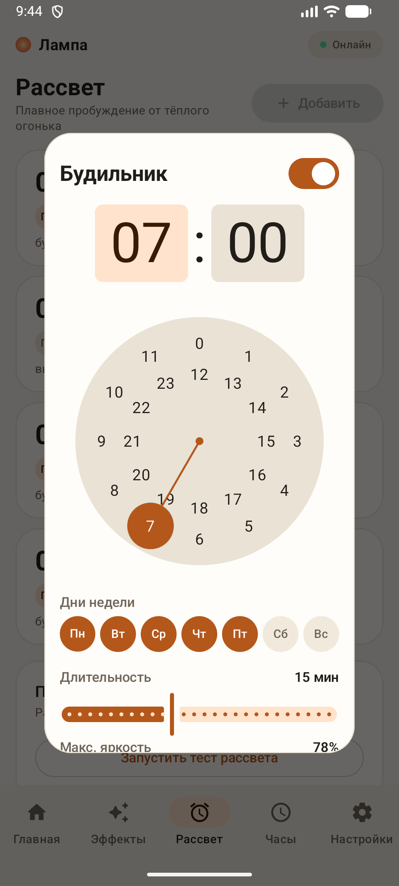
  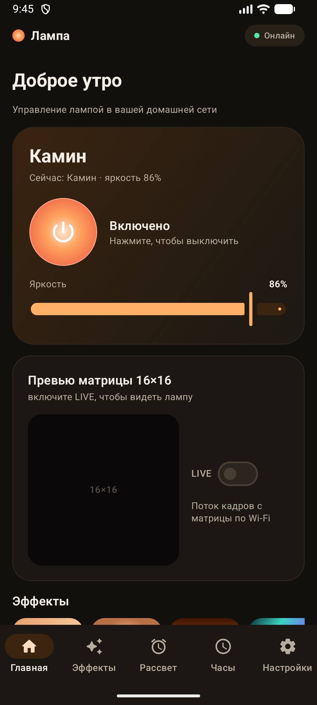
</p>

## Как это устроено

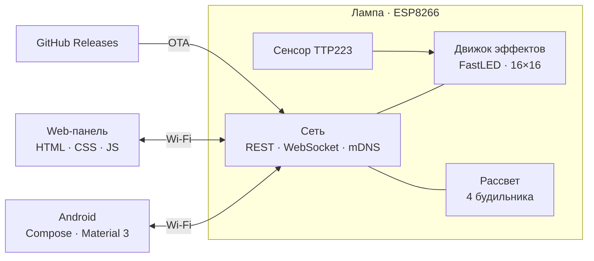

Прошивка построена как небольшое ядро реального времени: тик 16 мс, смена сцен с кроссфейдом, слой рассвета поверх эффектов и сетевое состояние, которое транслируется всем клиентам одновременно. Веб-интерфейс и Android-приложение не хранят состояние у себя — лампа остаётся единственным источником истины.

Таблица часовых поясов (IANA → POSIX) лежит во flash и генерируется скриптом `tools/gen-tz.mjs`; список зон отдаёт сама лампа, поэтому клиентам не нужны свои копии.

## Железо

| Компонент | Подключение |
| --- | --- |
| Матрица WS2812B 16×16 | DIN → D4 (GPIO2) через резистор 330–470 Ом |
| Сенсор TTP223 | OUT → D2 (GPIO4), питание 3.3 В |
| Питание ленты | внешний блок 5 В, 10–15 А, общая земля |

Матрицу нельзя питать от платы: белый свет на полной яркости требует до 15 А. Подробная схема, шифтер уровней, конденсаторы и вентиляция — в [docs/wiring.md](docs/wiring.md).

Рекомендуется 74AHCT125 между D4 и лентой: ESP выдаёт 3.3 В, а WS2812B надёжнее видит 5 В. Прошивка ограничивает суммарный ток по настройке «Питание» (500–15000 мА): если блок слабее 15 А, поставьте его номинал — лампа сама приглушит яркие сцены и не уйдёт в защиту.

## Быстрый старт

```bash
# 1. Собрать веб-интерфейс внутрь прошивки
npm run embed

# 2. Прошить плату по USB
cd firmware
pio run -t upload
pio run -t uploadfs
```

1. Подключитесь к открытой сети `Lampa-Setup`, выберите домашний Wi-Fi на странице настройки.
2. Откройте [http://lampa.local](http://lampa.local) или адрес из роутера.
3. Соберите приложение: `cd android && ./gradlew assembleDebug`, установите `app/build/outputs/apk/debug/app-debug.apk` — лампа найдётся по mDNS.

Подробности: [прошивка и первый запуск](docs/flash.md), [API](docs/api.md).

## Обновление прошивки

1. **С GitHub** — «Настройки → Прошивка → Проверить» в веб-панели или приложении; лампа покажет версию и заметки, установит по кнопке и перезагрузится.
2. **Из файла** — «Выбрать файл прошивки»: подойдёт любой `firmware.bin`.
3. **По воздуху из консоли** — `pio run -t upload --upload-protocol espota --upload-port lampa.local`.

Android-приложение обновляется само: «Настройки → Приложение → Проверить» скачает APK из релиза.

## Разработка

### Веб-панель

```bash
npm run mock     # локальный сервер с эмуляцией лампы: http://localhost:8080
npm run embed    # web/* → firmware/data + gzip для LittleFS
```

Веб-панель не использует сборщик и фреймворки: `index.html`, `styles.css`, `app.js`. Эмулятор `web/mock-server.mjs` повторяет REST, WebSocket, превью и сценарий рассвета — удобно проверять интерфейс без железа.

### Android

```bash
cd android
./gradlew assembleDebug
```

Нужны JDK 17+ и Android SDK 35. Приложение: Kotlin 2.0, Jetpack Compose, Material 3, OkHttp, kotlinx.serialization. Пакет `com.denvisss.lampa`.

### Прошивка

```bash
cd firmware
pio run          # сборка
pio run -t upload
pio device monitor
```

PlatformIO сам скачает ESP8266 Core, FastLED, ArduinoJson и WebSockets. Настройки эффектов, будильников и Wi-Fi хранятся в LittleFS и дублируются в EEPROM: переживают обновление прошивки и даже `uploadfs` с форматированием файловой системы.

Обновить таблицу часовых поясов (если IANA выпустила изменения):

```bash
node tools/gen-tz.mjs   # tools/tz-zones.csv → firmware/src/tzdata.h
```

## Структура репозитория

```
.
├── firmware/          прошивка ESP8266 (PlatformIO)
│   ├── src/           ядро, эффекты, рассвет, сеть, API, сенсор, OTA
│   └── data/          собранный веб-интерфейс для LittleFS
├── web/               веб-панель и её эмулятор
├── android/           приложение Kotlin + Compose
├── docs/              железо, прошивка, API, скриншоты
└── tools/             встраивание веба, таблица часовых поясов
```

## API коротко

| Метод | Путь | Назначение |
| --- | --- | --- |
| `GET` | `/api/state` | Полное состояние лампы |
| `POST` | `/api/state` | Частичное обновление настроек |
| `GET` | `/api/effects` | Каталог эффектов |
| `GET` | `/api/timezones` | Все часовые пояса (465 зон IANA) |
| `PUT` | `/api/alarms` | Расписания рассвета |
| `POST` | `/api/action` | Рассвет, ручное время, калибровка, шоу, сброс |
| `POST` | `/api/wifi` | Смена сети |
| `POST` | `/api/ota` | Прошивка файлом |
| `GET` | `/api/update/check` | Проверка обновления на GitHub |
| `POST` | `/api/update/install` | Установка обновления с GitHub |

WebSocket `ws://lampa.local:81/` присылает состояние, прогресс рассвета, прогресс OTA и бинарные кадры превью. Полный контракт — [docs/api.md](docs/api.md).

## Статус

Версия 1.1.0-pre1 работает на настоящей лампе: Wi-Fi, часы с ручной установкой и всеми часовыми поясами, калибровка матрицы, ограничение тока, обновление с GitHub и восстановление настроек из EEPROM после форматирования файловой системы проверены на железе. Веб-панель проверена в Chrome против живой лампы — от 390 px до десктопа; Android-приложение собрано и проверено на эмуляторе против живой лампы: экраны, живое превью, будильники, часы и обновления работают.

## Лицензия

[MIT](LICENSE) © denvisss
