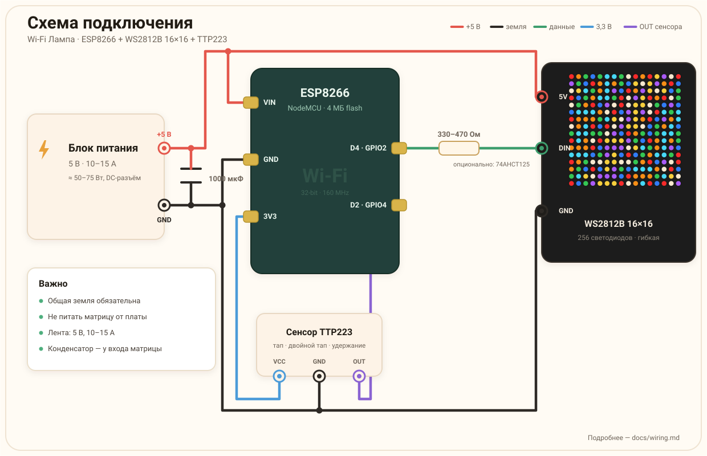
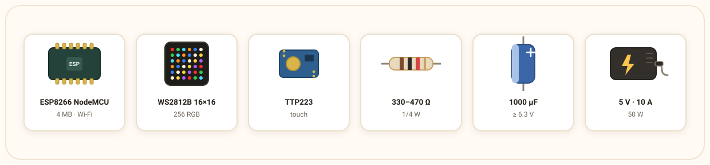

# Подключение и питание



## Компоненты



| Компонент | Кол-во | Зачем | Примечание |
| --- | --- | --- | --- |
| ESP8266 NodeMCU v2/v3 | 1 | «Мозг» лампы: Wi-Fi, эффекты, API | нужна плата с 4 МБ flash |
| Матрица WS2812B 16×16 | 1 | 256 светодиодов, гибкая лента | 5 В, ~1 А на цветные эффекты |
| Сенсорная кнопка TTP223 | 1 | тап, двойной тап, удержание | модуль с площадкой, питание 3,3 В |
| Резистор 330–470 Ом | 1 | согласование линии данных | 1/4 Вт, ставится к DIN матрицы |
| Конденсатор 1000 мкФ | 1 | сглаживает броски тока у матрицы | электролит ≥ 6,3 В |
| 74AHCT125 | 1 | шифтер 3,3 → 5 В для данных | опционально, для надёжности |
| Блок питания 5 В 10–15 А | 1 | питание матрицы | 50–75 Вт, DC-разъём 5,5×2,1 мм |
| DC-гнездо и клеммник | — | подключение БП и ленты | или аккуратная пайка |

Ссылки на покупку в России и Китае появятся здесь позже.

## Таблица соединений

| Сигнал | ESP8266 | Куда | Примечание |
|---|---|---|---|
| Данные матрицы | D4 (GPIO2) | DIN первого светодиода | через резистор 330–470 Ом, желателен шифтер 3.3→5 В |
| Сенсор | D2 (GPIO4) | OUT модуля TTP223 | питание сенсора 3.3 В, перемычки A/B не запаяны (режим momentary) |
| Питание матрицы | VIN/5V внешний | 5V ленты | **не питать ленту от платы** — ток до 15 А |
| Земля | GND | GND ленты + GND БП + GND сенсора | общая земля обязательна |

```
БП 5В 10–15А ──┬── 1000 мкФ ── лента 5V
               ├── лента GND ── ESP GND ── TTP223 GND
               └── (предохранитель 10А в плюсе)

ESP D4 ──[330Ω]──(74AHCT125 при наличии)── лента DIN
ESP D2 ─────────── TTP223 OUT
ESP 3V3 ────────── TTP223 VCC
ESP 3V3/GND ────── 74AHCT125 VCC/GND, OE → GND
```

## Почему шифтер уровней

Логика ESP8266 — 3.3 В, а WS2812B по даташиту считает «1» уровнем от 0.7 × VDD ≈ 3.5 В. На практике большинство лент работает и от 3.3 В, но на длинной линии или прохладной ленте возможны глюки. 74AHCT125 (или 74HCT125) даёт надёжный сигнал 5 В. Данные — вывод 1A → 1Y, OE посадить на GND, неиспользуемые входы — на GND.

## Ток и нагрев

- 16×16 = 256 светодиодов, максимум 60 мА на диод = **15.4 А при белом на 100%**.
- Рекомендуемый БП: 5 В, 10–15 А. Прошивка ограничивает суммарный ток (по умолчанию 9 А, номинал блока задаётся в настройках «Питание») и мягко кэпит яркость — эффекты используют 1–4 А.
- Конденсатор 1000 мкФ электролитический у входа ленты, керамика 100 нФ рядом.
- В трубке нужны вентиляционные щели сверху/снизу, чтобы светодиоды не перегревались.
- Инжекция питания: подключить 5V/GND к **обоим концам** ленты — просадки на дальнем конце почти исчезают.

## Матрица и цилиндр

Лента гибкой матрицы намотана вокруг трубки: 16 пикселей по кругу, 16 по высоте. Порядок укладки не важен — в прошивке есть маппинг:

- змейка/по колонкам,
- зеркало направления,
- сдвиг по кругу (offset 0–15),
- переворот по вертикали.

Калибровка выполняется из веб-интерфейса: узор «сетка» показывает оси цветом, узор «бегущая точка» — направление обхода. Это в 2–3 нажатия подбирает правильную ориентацию без перепайки.

## Первый запуск

1. Прошей прошивку и файловую систему (см. [flash.md](flash.md)).
2. Плата поднимает точку доступа `Lampa-Setup` (если Wi-Fi ещё не настроен).
3. Подключись с телефона, откроется портал настройки — выбери домашнюю сеть, введи пароль.
4. Лампа перезагрузится и станет доступна как `http://lampa.local` и по IP в роутере.
